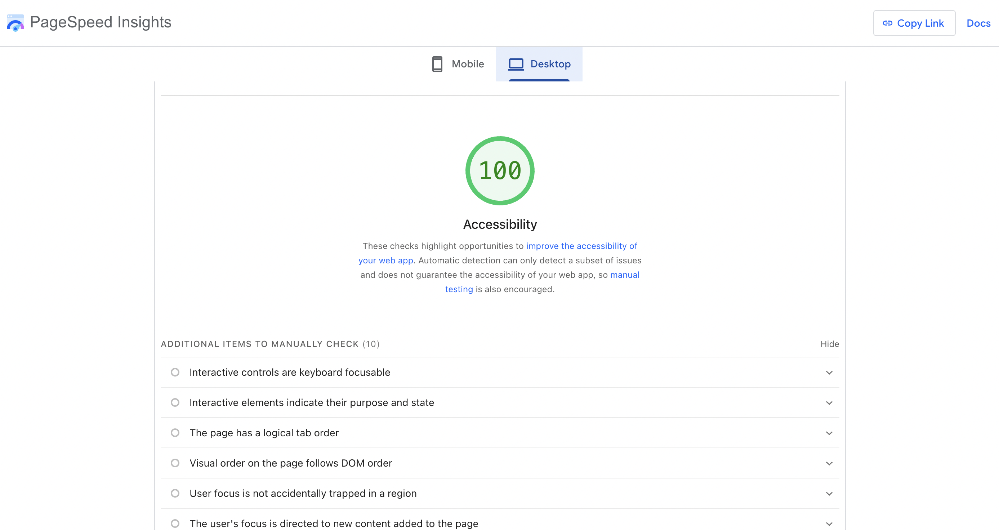

# Accessibility Audit

**Site:** [Avnee Jain | Portfolio](https://fanciful-pastelito-b91d52.netlify.app/)
**Audit date:** November 5, 2026
**Tools:** [PageSpeed Insights](https://pagespeed.web.dev/) (Lighthouse 12), axe-core 4.10, W3C Markup and CSS Validators, and manual keyboard testing in Chrome

## Summary

| | Before | After |
| --- | :---: | :---: |
| PageSpeed Insights accessibility (mobile) | 96 | **100** |
| PageSpeed Insights accessibility (desktop) | 96 | **100** |
| axe-core violations (WCAG 2.2 AA + best practices) | 2 issues (32 elements) | **0** |
| W3C HTML / CSS validation errors | 0 | 0 |



## Findings and fixes

### 1. Tag text did not have enough color contrast (WCAG 1.4.3, Level AA)

**Found by:** PageSpeed Insights (`color-contrast`) on 31 elements: every skill and project tag (for example "PYTHON", "FIGMA", "UX").

**Problem:** Tags used the accent pink `#c2306b` on light pink `#fbd3e2`, a contrast ratio of **3.94:1**. The tags are small bold text (about 11.5px), so WCAG requires at least **4.5:1**. Low-contrast text is hard to read for people with low vision or color blindness, or anyone reading in bright light.

**Fix:** I changed the tag text to the darker pink already in my palette, `--color-pink-dark` (`#9e2156`), and bumped the size slightly. The new ratio is **5.53:1**. I made the same change to the decorative star bullets on the yellow "When I'm not working" card, which were 4.28:1.

```css
.tags li {
  background-color: var(--color-pink-soft);
  color: var(--color-pink-dark); /* was var(--color-pink), 3.94:1 → 5.53:1 */
  font-size: 0.75rem;            /* was 0.72rem */
}
```

### 2. Sidebar landmark was nested inside another landmark (best practice)

**Found by:** axe-core (`landmark-complementary-is-top-level`).

**Problem:** The Toolkit / "When I'm not working" sidebar was an `<aside>` inside the About `<section>`. Screen reader users navigate by landmarks, and a complementary landmark buried inside another region shows up in the landmarks list without clear context.

**Fix:** The sidebar is part of the About section's content, not a separate region of the page, so I changed the `<aside>` to a plain `<div class="sidebar">`. Its headings ("Toolkit", "When I'm not working") still make it easy to find with heading navigation.

## Keyboard navigation improvements

Lighthouse can't fully test keyboard use, so I tested every interactive element by hand, using only Tab, Shift+Tab, Enter, and Space. I also made these improvements:

| Improvement | Why it matters |
| --- | --- |
| **Skip link moves focus into the content.** `<main>` now has `tabindex="-1"`, so "Skip to main content" moves keyboard focus, not just the scroll position. The next Tab goes straight to "See my projects" instead of back through the nav. | Keyboard and screen reader users don't have to tab through the navigation on every visit. |
| **Skip link is clearly visible when focused.** It appears as a large pink pill in the top-left corner. | Sighted keyboard users can see that the shortcut exists. |
| **"Back to top" returns you and your focus to the top.** The `top` anchor is now on `<body>`, so the link scrolls to the very top and the next Tab starts again at the skip link. | Before, the anchor sat inside the sticky header: the page could scroll without focus following along. |
| **The sticky header never covers the focused element.** `scroll-padding-top: 6rem` keeps anything you tab to below the sticky nav. | Meets WCAG 2.4.11 Focus Not Obscured (2.2, Level AA). |
| **Experience cards use native `<details>`/`<summary>`.** Each role opens and closes with Enter or Space and is announced as expanded or collapsed. The "+" rotates into an "×" when a card is open. | Works with the keyboard and screen readers without any JavaScript. |
| **Visible focus indicators everywhere.** Links, buttons, and cards get a 3px pink outline (5.04:1 against the background). Form fields get a pink border plus a soft glow ring. Footer links switch to a gold outline (13.7:1 against the dark footer). | Meets WCAG 2.4.7 Focus Visible. Every focus indicator is at least 3:1 against its background. |
| **Form instructions.** I added "All fields are required." above the form. Every field already has a visible `<label>`. | Users know what's expected before they submit. |
| **Reduced motion.** Smooth scrolling and hover/lift transitions turn off when the user's system asks for reduced motion. | Respects `prefers-reduced-motion`. |

**Tab order** follows the visual order: Skip link → Logo → Home → About → Projects → Contact → Let's talk → See my projects → Get in touch → 4 experience cards → Email → LinkedIn → GitHub → Name → Email → Message → Send message → footer links → Back to top. There are no keyboard traps.

## Manual checks

PageSpeed Insights lists these as "additional items to manually check." Here's how the site handles each one:

| Check | Result |
| --- | --- |
| Interactive controls are keyboard focusable | ✅ All links, `<summary>` toggles, inputs, and the button are native elements |
| Interactive elements indicate their purpose and state | ✅ Hover, focus, and open/closed states are all styled |
| The page has a logical tab order | ✅ Matches the visual order (see above) |
| Visual order on the page follows DOM order | ✅ Floats keep content in source order; nothing is reordered with CSS |
| User focus is not accidentally trapped | ✅ Tabbed through the whole page, forward and backward |
| The user's focus is directed to new content | ✅ The skip link and Back to top now move focus |
| HTML5 landmark elements are used | ✅ `header`, `nav`, `main`, `section`, `footer`, `address` |
| Offscreen content is hidden from assistive technology | ✅ The only offscreen element is the skip link, which is meant to be focusable |
| Custom controls have labels and roles | ✅ No custom widgets; native HTML only |

## Color contrast reference

Every text color pair on the site, checked against WCAG AA (4.5:1 for normal text):

| Text / background | Ratio | Result |
| --- | :---: | :---: |
| Ink `#2b1424` on page `#fff6f9` | 16.12:1 | ✅ AAA |
| Muted `#7a4a63` on page `#fff6f9` | 6.63:1 | ✅ AA |
| Pink `#c2306b` on white | 5.34:1 | ✅ AA |
| White on pink button `#c2306b` | 5.34:1 | ✅ AA |
| **Tag: pink-dark `#9e2156` on pink-soft `#fbd3e2`** | **5.53:1** | ✅ AA (was 3.94:1 ❌) |
| Ink on gold card `#ffe58a` | 13.70:1 | ✅ AAA |
| Footer: pink-soft `#fbd3e2` on ink | 12.63:1 | ✅ AAA |
| Footer: gold `#ffe58a` on ink | 13.70:1 | ✅ AAA |

## Keyboard navigation video

A 1–2 minute narrated video of me browsing the site using only the keyboard: [link to video]
